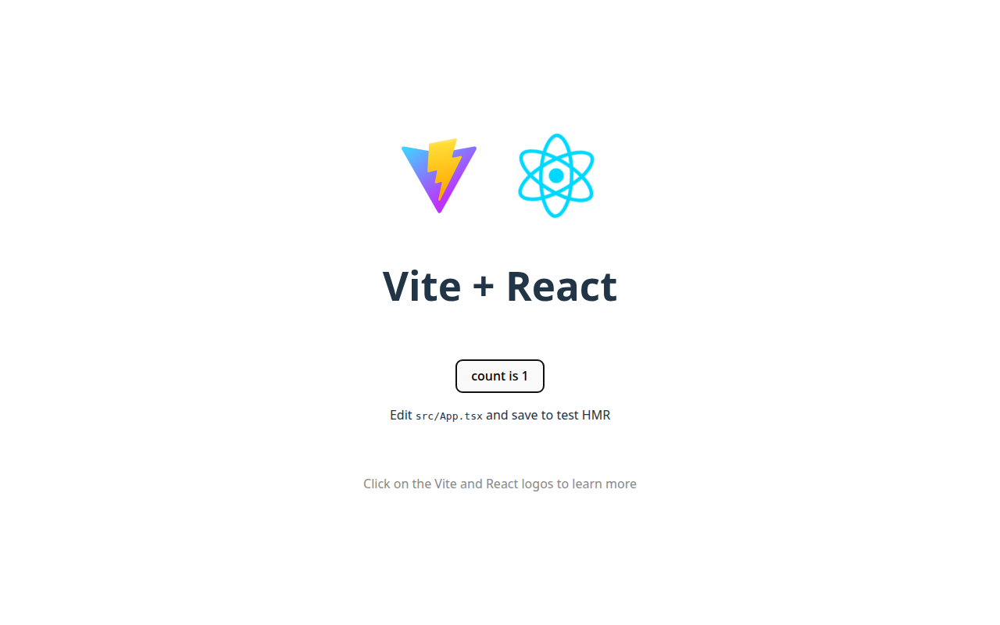

<p align="right"><a href="README.md">中文</a></p>

<p align="center">
  
</p>

<p align="center">
  <a href="https://xiaosang.cc/pre-tax-salary-calculator/">▶ Live Demo</a>
  ·
  <a href="https://github.com/holynova/pre_tax_salary_calculator">GitHub Repository</a>
</p>

Pre-Tax Salary Calculator: the goal is two-way salary conversion — forward (gross pay → take-home pay) and reverse (take-home pay → gross pay). The repository is currently a Vite + React + TypeScript scaffold; the calculation feature is not implemented yet.

## Screenshot

<p align="center">
  
</p>

> The screenshot shows the current code as it is. The older `screenshot.png` at the repo root is an early interface from August 2026 (two empty forward/reverse lists) that no longer matches the code; it is kept for historical reference only and is not referenced here.

## Status

- **Ready**: a Vite 6 + React 18 + TypeScript 5 scaffold; `npm run build` passes, and the build output matches the deployed site.
- **Not implemented**: the salary conversion logic (social insurance, income tax, forward/reverse conversion UI) is not in the code yet — `src/App.tsx` is still the default Vite counter page.
- **Next step**: wire a conversion form and the calculation logic into `App.tsx`.

## Planned Features

- **Forward conversion**: enter gross pay, get social insurance, income tax, and take-home pay.
- **Reverse conversion**: enter take-home pay, work back to the corresponding gross pay.
- (The above is the planned direction implied by the repo name and the early screenshot; it is not implemented yet.)

## Run Locally

```bash
npm install
npm run dev      # Dev server with HMR
npm run build    # Type-check + production build
npm run lint     # ESLint check
```

## Tech

- React 18.3 + TypeScript 5.6 + Vite 6, ESLint 9 (typescript-eslint).
- Zero business dependencies: `package.json` has only `react` / `react-dom` at runtime.

```
index.html          Entry; the title is still the template default "Vite + React + TS"
src/main.tsx        React entry
src/App.tsx         Current page (default template counter, to be replaced by the conversion UI)
src/App.css         Page styles
src/index.css       Global styles
vite.config.ts      Vite config (@vitejs/plugin-react)
tsconfig.*.json     TypeScript configs (app / node split)
eslint.config.js    ESLint 9 flat config
```
