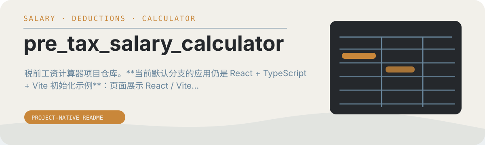

# pre_tax_salary_calculator

税前工资计算器项目仓库。**当前默认分支的应用仍是 React + TypeScript + Vite 初始化示例**：页面展示 React / Vite 标志和点击计数器，尚未包含工资反推计算逻辑。

<p align="center">
  
</p>


## 当前代码与预览

- [src/App.tsx](src/App.tsx)：当前计数器示例。
- [src/main.tsx](src/main.tsx)：React 入口。
- [screenshot.png](screenshot.png)：仓库保留的项目截图，不能据此判断当前源码已经实现计算器。

## 本地运行

```bash
npm install
npm run dev
```

打开终端输出的地址，当前预期看到的是 Vite 示例页。

## 检查与构建

```bash
npm run lint
npm run build
npm run preview
```

`build` 先进行 TypeScript 检查，再生成生产资源；`preview` 启动本地构建预览。工资计算功能需要另行实现，README 不将初始化示例描述为可用的计算器。
