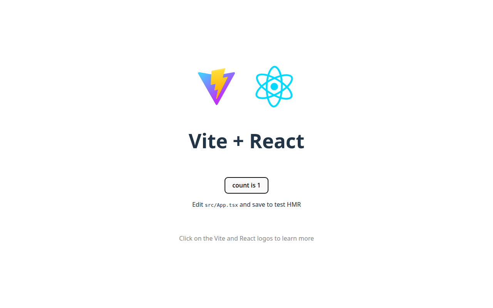

<p align="center">
  
</p>

<p align="center">
  <a href="https://xiaosang.cc/pre-tax-salary-calculator/">▶ 在线体验 Online Demo</a>
  ·
  <a href="https://github.com/holynova/pre_tax_salary_calculator">GitHub 仓库</a>
</p>

税前工资计算器：目标是做税前 ⇄ 税后的双向工资换算——正向从税前工资算到手收入，反向从到手收入反推税前工资。目前仓库是 Vite + React + TypeScript 脚手架，计算功能尚未实现。

Pre-Tax Salary Calculator: the goal is two-way salary conversion — forward (gross pay → take-home pay) and reverse (take-home pay → gross pay). The repository is currently a Vite + React + TypeScript scaffold; the calculation feature is not implemented yet.

## 截图 / Screenshots

<p align="center">
  
</p>

> 截图为当前代码实拍。仓库根目录的旧 `screenshot.png` 是 2026 年 8 月更新的早期界面（正向 / 反向两个空列表），与当前代码不一致，仅作历史参考，未在新 README 中引用。

## 现状 / Status

- **已就绪**：Vite 6 + React 18 + TypeScript 5 脚手架，`npm run build` 实测可构建通过，产物与线上部署一致。
- **未实现**：工资换算逻辑（五险一金、个税计算、正向 / 反向换算界面）目前都不在代码里——`src/App.tsx` 仍是 Vite 模板默认的计数器页面。
- **下一步**：在 `App.tsx` 中接入换算表单与计算逻辑。

## 计划功能 / Planned Features

- **正向换算**：输入税前工资，算出五险一金、应纳个税与到手工资。
- **反向换算**：输入到手工资，反推对应的税前工资。
- （以上为仓库命名与早期截图所示的规划方向，尚未实现。）

## 本地运行 / Run Locally

```bash
npm install
npm run dev      # 开发服务器，带 HMR
npm run build    # 类型检查 + 生产构建
npm run lint     # ESLint 检查
```

## 技术 / Tech

- React 18.3 + TypeScript 5.6 + Vite 6，ESLint 9（typescript-eslint）。
- 零业务依赖：`package.json` 里只有 `react` / `react-dom` 两个运行时依赖。

```
index.html          入口，标题仍为模板默认 "Vite + React + TS"
src/main.tsx        React 入口
src/App.tsx         当前页面（模板默认计数器，待替换为换算界面）
src/App.css         页面样式
src/index.css       全局样式
vite.config.ts      Vite 配置（@vitejs/plugin-react）
tsconfig.*.json     TypeScript 配置（app / node 分离）
eslint.config.js    ESLint 9 平铺配置
```

## English

**Pre-Tax Salary Calculator** aims to convert salaries both ways: gross pay → take-home pay, and take-home pay → gross pay.

- **Current state**: a working Vite 6 + React 18 + TypeScript 5 scaffold. `npm run build` passes; the deployed site matches this build. The calculator itself is not implemented yet — `src/App.tsx` is still the default Vite counter page.
- **Planned**: forward conversion (gross → net, with social insurance and income tax) and reverse conversion (net → gross).
- **Run it**: `npm install`, then `npm run dev` (HMR dev server) or `npm run build` (type-check + production build).
- **Tech**: React 18.3, TypeScript 5.6, Vite 6, ESLint 9. No business dependencies — only `react` and `react-dom` at runtime.

## 许可 / License

本仓库未声明许可证，`package.json` 标记为 `private`。
